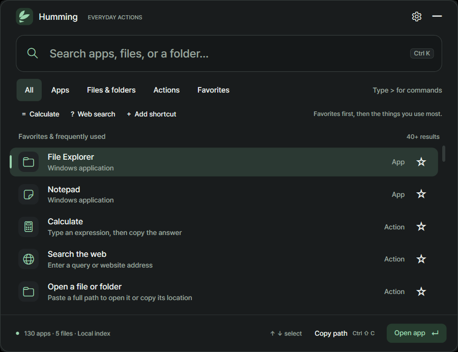
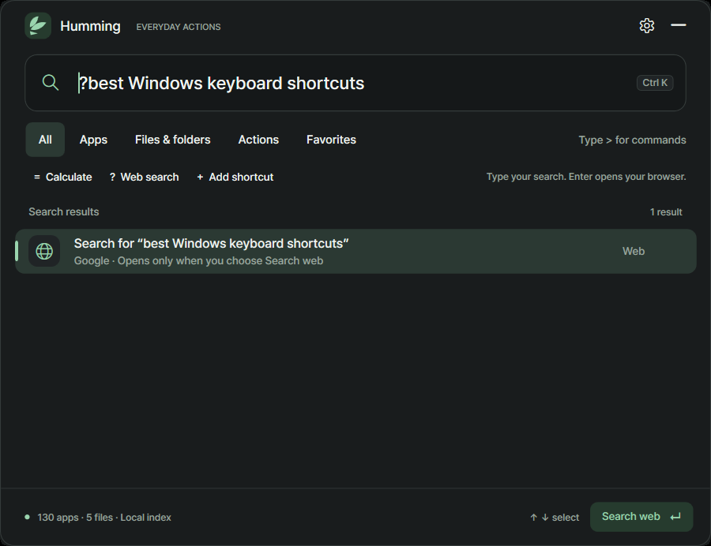
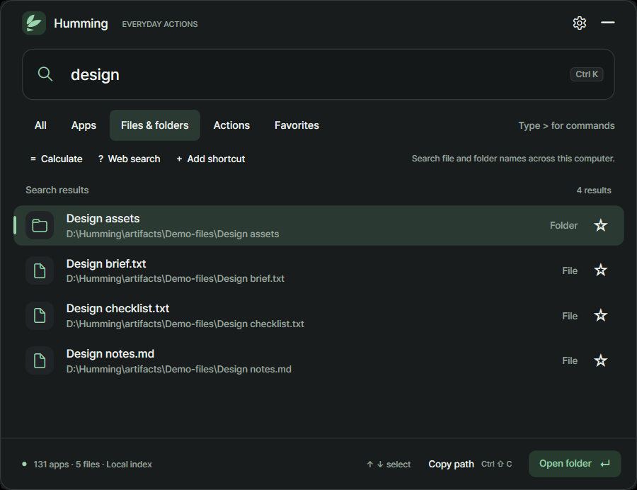

# Humming

## One shortcut for apps, files, calculations, and Google searches.

Humming brings everyday Windows tasks into one compact launcher. Open an app, find a file by name, copy a folder's path, work out a calculation, or send a deliberate search to Google—all from the same search field.

**Current beta: 0.1.0-beta.4 · Windows 11 x64**

[**Download Windows Setup**](https://github.com/memeseonew-eng/Humming/releases/download/v0.1.0-beta.4/HummingSetup-0.1.0-beta.4-win-x64.exe) · [**Download portable ZIP**](https://github.com/memeseonew-eng/Humming/releases/download/v0.1.0-beta.4/Humming-0.1.0-beta.4-win-x64.zip) · [Release notes](https://github.com/memeseonew-eng/Humming/releases/tag/v0.1.0-beta.4)

The runtime is included. This beta's app and installer are unsigned; Windows may show a publisher or reputation warning. Use the release above for official downloads and published checksums.

## New in beta.4

A small floating Humming button is ready when you want the mouse instead of a keyboard shortcut. With background mode on, a circular button appears along your screen edge while the launcher is hidden. Click it to open Humming immediately or drag it to either edge to keep it out of the way. The icon disappears while the launcher is open and comes back when dismissed.

In Preferences, choose whether to display the button and select a PNG/JPEG or Windows-supported WebP image. Humming crops it to a 160-pixel thumbnail, strips original metadata and saves it locally only when you choose Save preferences. Use Humming icon restores the original artwork. Right-click the floating icon for Open, Preferences, Hide floating icon and Quit.

The existing hotkey, tray menu, light/dark themes, reduced motion and Windows startup controls continue to work. Background mode Off keeps the icon hidden because dismissal exits the app.

## A small place for the things you do often

- **Launch apps and saved shortcuts.** Search installed Start Menu apps, or save your own app, file, folder, or website with an optional alias.
- **Find files across your local drives.** Automatic filename indexing starts in the background; you do not have to add search folders first.
- **Search Google when you choose.** Click **Web search** or type `?` followed by a query, then press **Enter**.
- **Calculate and copy.** Click **Calculate** or start with `=`. Press **Enter** on the result to copy the answer.
- **Copy a location.** Select a local result and choose **Copy path**, or press **Ctrl+Shift+C**.
- **Keep familiar items close.** Favorites, successful-use frequency, and recency personalize the list. Strong text matches retain priority while you type.

Choose **All**, **Apps**, **Files & folders**, **Actions**, or **Favorites** to narrow the list. Visible action buttons and keyboard shortcuts work together, so you can start with either.

## Google search, on purpose

Type `? windows keyboard shortcuts`, choose **Search web**, and Humming opens that search on Google in your browser. Typing the query does not send a request; activating the result does. You can also paste a complete HTTP or HTTPS address to open a website.

Local filename queries are processed on your PC. Google searches and website shortcuts use your browser.

## Find a file without choosing its folder first

Select **Files & folders** and type part of a filename. Humming builds a persistent local index of file and folder names on accessible fixed and removable drives. Search supports multiple words, literal punctuation, and Korean names and initial consonants.

The first scan takes time. Results become available as indexing progresses, and the status shows when indexing is running or some locations could not be read. Later launches can use the saved index while Humming checks for changes.

In **Preferences → Computer file search**, you can:

- Enable or turn off computer file search.
- Pause background indexing while keeping cached results searchable.
- Exclude folders from automatic discovery. Your explicitly saved shortcuts remain available.
- Rebuild the filename index.

Choose **Save preferences** to apply search, pause, and exclusion changes. Resume indexing before using **Refresh files** or **Rebuild file index**.

Indexing and change monitoring run while Humming is running. This is a filename index: file contents are not read. Coverage depends on available drives and permissions; network shares, link/junction traversal, and inaccessible locations are outside automatic discovery. Cached results can be out of date while indexing is paused or a drive is unavailable.

## A few keystrokes to get started

After starting Humming, press **Ctrl+Alt+Space** to open or dismiss the launcher. You can change that global shortcut in Preferences.

| Task | What to do |
|---|---|
| Open an app, file, or folder | Type its name, select a result, and press **Enter** |
| Search Google | Click **Web search**, or type `? your query`, then **Enter** |
| Calculate | Click **Calculate**, or type `= (18 + 6) / 3`; **Enter** copies `8` |
| Use a known location | Paste a full local file or folder path |
| Find a built-in action | Type `>`, or choose **Actions** |
| Refresh installed apps | Type `> refresh apps` and select **Refresh apps** |
| Save an alias | Click **Add shortcut** and enter a name, target, and optional alias |

The `=` and `?` examples work in **All** or **Actions**. The visible Calculate and Web search buttons select the appropriate mode for you. Actions are built-in Humming tasks; search text is never evaluated as a shell command.

| Shortcut | Action |
|---|---|
| **Ctrl+Alt+Space** | Open or dismiss Humming using the default global shortcut |
| **↑ / ↓** | Select a result while using the search field |
| **Enter** | Perform the selected result's displayed action |
| **Ctrl+K** | Focus the search field and select its text |
| **Ctrl+D** | Toggle the selected item's favorite star |
| **Ctrl+Shift+C** | Copy the selected local target's path |
| **Ctrl+,** | Open Preferences |
| **Esc** | Clear a nonempty query; with an empty query, dismiss Humming |

For a Start Menu app, **Copy path** copies the shortcut file's path. Some indexed file types can be found and copied but are not permitted to open through Humming.

## Make it yours

Choose a light or dark theme, reduce motion, customize the global shortcut, and add named shortcuts for frequently used targets.

The optional floating launcher is draggable and remembers the current screen, left/right edge and vertical placement. It adjusts to the usable screen area when a monitor changes. It does not steal focus while idle. Turn it off from Preferences or the floating icon's right-click menu. With an empty search, favorites come first, followed by usage frequency and recency. Successful completed actions update local usage; merely entering a mode or copying a path does not count as a launch.

Clear usage history in Preferences and save the change when you want a fresh start. Transient Google query text and calculator expressions are not saved as usage-history entries.

## Setup or portable

| | Windows Setup | Portable ZIP |
|---|---|---|
| Start | Run `HummingSetup-0.1.0-beta.4-win-x64.exe`, then open Humming from Start | Extract `Humming-0.1.0-beta.4-win-x64.zip` to a writable folder, then open `Humming.exe` |
| Installation | Per Windows account; optional desktop shortcut | No installer |
| Default data folder | `%LOCALAPPDATA%\Humming` | `data\` beside `Humming.exe` |
| Update | Quit Humming and run the new Setup; the data folder is retained | Quit Humming and keep `data\` when replacing program files |
| Removal | Uninstall removes program files and retains the data folder | Keep or remove the extracted folder and its data as you choose |

The two modes use different default data folders. Only one Humming instance runs in a Windows session; use `> quit` or the tray's Quit action before switching copies.

### Choose when Humming runs

**Run in the background is On by default.** Dismissing the launcher keeps it in the tray, ready for your global shortcut and optional floating icon. Turn it Off to exit when you close or dismiss the launcher, or after opening an external result. Clicking elsewhere leaves the window visible in this mode.

**Start with Windows is Off by default.** Enable it in **Preferences → Background & startup** and save to launch this copy when you sign in. With background mode On it starts quietly in the tray; with background mode Off it opens the launcher. The two switches are independent.

Windows startup belongs to the current computer and app location. After moving a portable folder or restoring your project on another computer, enable it again if wanted. Uninstall removes only the installed copy's startup entry.

This beta uses manual updates. Check the [releases page](https://github.com/memeseonew-eng/Humming/releases) for the next version.

### Keep personal data separate from downloads

Preferences, the floating thumbnail and its position, shortcuts, favorites, and usage live in `settings.json`, with a recovery `settings.json.bak`, inside the data folder. The `index\` subfolder is a rebuildable filename cache.

For a private settings save, quit Humming and copy the settings files. Exclude `index\` from that save; the cache can be rebuilt on the destination PC. Settings may contain personal paths, website targets and your floating picture, so keep your own backup private. Release downloads do not include a personal profile or filename index.

## Current beta

This release is intended for early feedback on Windows 11 x64. Initial indexing speed and search latency depend on your drives, inventory, permissions, and current workload. Broader accessibility, mixed-monitor/DPI, slow-device, and separate clean-PC validation remain ongoing.

Read the [beta release notes](releases/v0.1.0-beta.4.md) and [changelog](CHANGELOG.md), or [report an issue](https://github.com/memeseonew-eng/Humming/issues). Include the Humming version, Windows version, steps to reproduce, and whether indexing was active or paused. Remove personal paths, filenames, and queries from anything you share.

This repository contains public downloads, screenshots, release information, and version metadata. Application development source and private project history are not published here.
## Use, reuse and privacy

Humming is free to use for personal and internal business tasks under the [Humming terms](LICENSE.txt). This is a proprietary binary distribution. Permission to use the app does not grant permission to extract or reuse protected Humming code, artwork or branding for another product, or to use protected material in AI training datasets. Third-party components retain their own licenses, and statutory exceptions remain unaffected.

Reviews, attributed screenshots and official download links are welcome. Ordinary use with an assistant or accessibility tool is permitted, as is good-faith security or interoperability research under the included terms. Read the [privacy and local-data information](PRIVACY.md) before sharing profiles, backups or issue reports.

Beta.2 adds release protection and stricter packaging checks. Private identifiers in the Core, Windows and Indexing libraries are obfuscated, and Humming debug/source-location metadata is omitted. Public interfaces, data contracts and WPF UI resources remain readable. These measures deter casual copying; they do not make the executable impossible to inspect. The app remains usable offline without an account or license-server check.
