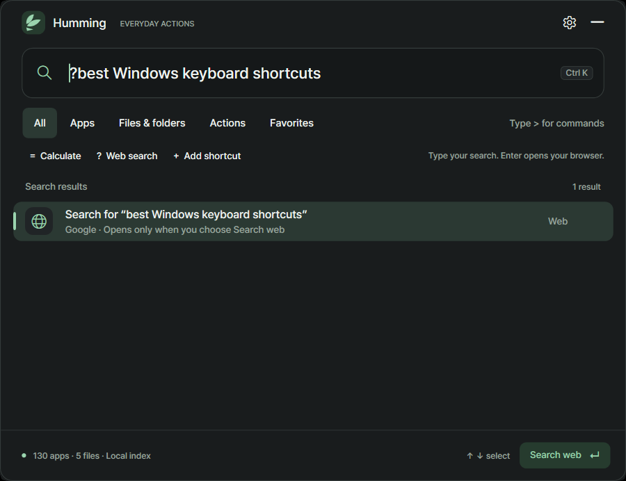
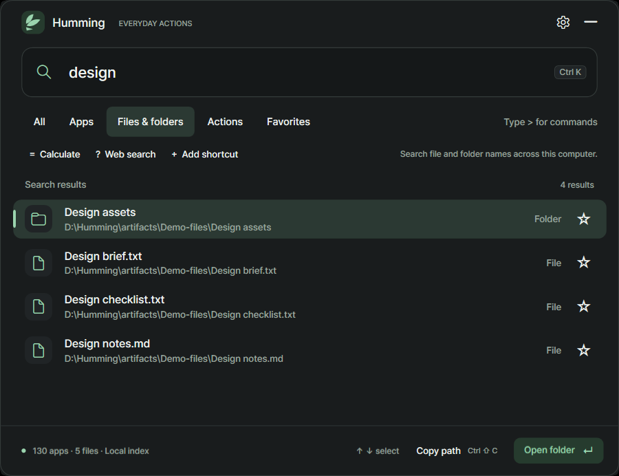

# Humming 0.1.0-beta.1

## One launcher for the next thing you need.

The first Humming beta brings apps, local files, folders, calculations, saved shortcuts, and explicit Google searches into one compact Windows launcher. Press **Ctrl+Alt+Space**, type, and choose an action.

**Windows 11 x64 · First beta · Runtime included · Unsigned**

[**Download Windows Setup**](https://github.com/memeseonew-eng/Humming/releases/download/v0.1.0-beta.1/HummingSetup-0.1.0-beta.1-win-x64.exe) · [**Download portable ZIP**](https://github.com/memeseonew-eng/Humming/releases/download/v0.1.0-beta.1/Humming-0.1.0-beta.1-win-x64.zip)

[Release page and checksums](https://github.com/memeseonew-eng/Humming/releases/tag/v0.1.0-beta.1)

## What you can do

### Move between local tasks and Google search

Find an installed Start Menu app, open a file or folder, use a saved alias, or paste a complete website address. Choose **Web search** or type `? your query` to prepare a Google search; **Enter** or **Search web** sends it to your browser. Ordinary local searches stay local.

The Calculate and Web search buttons switch into the appropriate mode. For a calculation, try `= (18 + 6) / 3` and press **Enter** to copy the answer.

### Search filenames across your computer

Automatic indexing discovers file and folder names on accessible local fixed and removable drives without a per-folder setup step. The first scan runs progressively in the background; later launches reuse a persistent local cache while changes are checked.

Search by part of a filename, multiple words, or Korean initial consonants. In **Preferences → Computer file search**, you can pause indexing, exclude folders, or rebuild the index. **Save preferences** applies the search options. Cached results remain searchable while paused; resume before refreshing or rebuilding.

### Keep frequent work close

Star an item with **Ctrl+D**, copy a local path with **Ctrl+Shift+C**, and use **↑ / ↓** then **Enter** to act. Empty searches put favorites first, then frequency and recency; typed searches preserve strong text matches. Completed actions update local usage without storing transient Google query text or calculation expressions.

Use **Actions** or `>` for Humming's built-in tasks, including app refresh, file refresh, settings, and keyboard help. These actions do not provide arbitrary shell-command execution.

Light and dark themes, reduced motion, a configurable global shortcut, and saved shortcut aliases are included.

## Choose your download

| Download | Use it when | Default personal data |
|---|---|---|
| `HummingSetup-0.1.0-beta.1-win-x64.exe` | You want a per-user installation and Start Menu shortcut | `%LOCALAPPDATA%\Humming` |
| `Humming-0.1.0-beta.1-win-x64.zip` | You want to extract and run from a writable folder | `data\` beside `Humming.exe` |

Quit Humming from its tray menu before updating or switching copies. Setup retains the data folder on update and uninstall. For portable updates, preserve `data\` while replacing program files. Setup and portable use separate default profiles.

The filename cache in `index\` is rebuildable. Exclude it from a private settings save; retain your settings files privately. Public downloads contain no personal settings or filename inventory.

## Know before you install

- **Unsigned beta.** Neither the app nor Setup is digitally signed in this release. Windows may display a publisher or reputation warning. Use this release's official assets and published checksums.
- **Initial indexing takes time.** Results and coverage grow during the first scan. The status distinguishes active indexing and locations that could not be read.
- **Local filename coverage has boundaries.** File contents are not read. Network shares, link/junction traversal, inaccessible locations, and unavailable drives are outside automatic discovery. Cached entries may be stale while paused or offline.
- **Indexing runs while Humming runs.** Humming does not automatically start with Windows. The beta also has no automatic updater.
- **Finding a file does not guarantee it can be opened.** Script and other restricted file types may be searchable and copyable while activation remains blocked.
- **Wider validation continues.** Separate clean-PC, broad accessibility, mixed-monitor/DPI, and slow-device coverage are not claimed by this beta. Performance depends on hardware and inventory.

## Quick keys

**Ctrl+Alt+Space** opens or hides Humming. **Ctrl+K** selects the search text. **Ctrl+D** toggles a favorite. **Ctrl+Shift+C** copies a local path. **Ctrl+,** opens Preferences. **Esc** clears the query first, then hides the launcher when the query is empty.

[Read the guide](https://github.com/memeseonew-eng/Humming#readme) · [Report an issue](https://github.com/memeseonew-eng/Humming/issues)

For feedback, include your Humming version, Windows version, and reproducible steps. Remove personal paths, filenames, and query text from screenshots or logs before posting.
