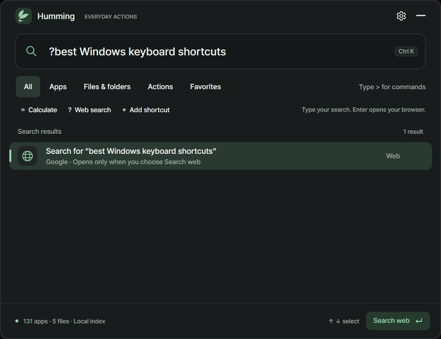
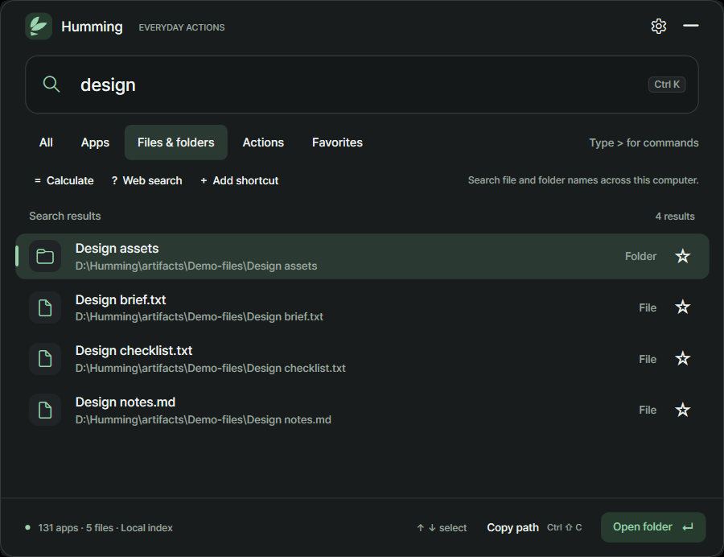

# Humming 0.1.0-beta.2
## One shortcut. Your apps, files, calculations and deliberate web searches.

This beta strengthens release protection and documents how your local data is handled. Humming remains a small offline Windows launcher, with browser access when you choose a web action.

[**Download Windows Setup**](https://github.com/memeseonew-eng/Humming/releases/download/v0.1.0-beta.2/HummingSetup-0.1.0-beta.2-win-x64.exe) · [**Download portable ZIP**](https://github.com/memeseonew-eng/Humming/releases/download/v0.1.0-beta.2/Humming-0.1.0-beta.2-win-x64.zip) · [SHA-256 checksums](https://github.com/memeseonew-eng/Humming/releases/download/v0.1.0-beta.2/SHA256SUMS.txt)

**Windows 11 x64. Runtime included. App and Setup unsigned.**

## What changed

- **Clear use and reuse terms.** Use Humming for personal and internal business tasks. Reviews and attributed screenshots are welcome. Reusing protected Humming code, artwork or branding in another product or an AI training dataset requires permission, subject to applicable law.
- **Light protection of internal implementation.** Private identifiers in the core, Windows and file-index libraries are obfuscated. UI bindings, saved-data contracts and native interfaces remain compatible.
- **Less build metadata in the download.** Humming debugging symbols and original source-location metadata are omitted.
- **Stricter packaging checks.** Every nested public file is checked against an explicit allowlist, third-party notices are hash-checked, and targeted scans check accidental private paths, secret signatures and screenshot metadata.
- **A readable privacy statement.** The included [privacy document](https://github.com/memeseonew-eng/Humming/blob/v0.1.0-beta.2/PRIVACY.md) explains local storage, browser searches and private backups.

These measures deter casual copying. They do not make a Windows executable impossible to inspect or copy. Local settings and indexes are not encrypted.

## Web search that starts with your choice

Click **Web search** or type `? windows keyboard shortcuts`, then press **Enter**. Humming opens the Google search in your browser. Preparing a query does not contact Google; activating it does. Ordinary app and filename queries stay on your computer.

## Keep everyday tasks together

- Open installed apps, saved shortcuts, files and folders.
- Search file and folder names across accessible local drives without adding folders first.
- Calculate and copy the answer, or copy a selected file's path.
- Save aliases and favorites; successful-use frequency and recency help order familiar results.
- Choose light or dark appearance, reduced motion and your global shortcut.

## Upgrade from beta.1

Quit Humming before updating. Run the new Setup, or extract the portable ZIP and replace program files while retaining your `data/` folder. Setup retains its separate `%LOCALAPPDATA%\Humming` profile. No settings migration is required.

**Run in the background defaults On. Start with Windows defaults Off.** Both remain independent options in Preferences. Moving a portable copy does not automatically register startup on another machine.

Beta.2 is the primary download. Public beta.1 downloads are retired; their original artifacts are retained privately with unchanged bytes and checksums. Copies already downloaded are unaffected.

## Privacy, terms and beta limits

The app has no account, telemetry, remote license check or automatic updater. Web and website actions use your browser and the selected provider's policies. Settings and filename caches stay local; release downloads contain no personal profile or computer index.

Read the included [Humming terms](https://github.com/memeseonew-eng/Humming/blob/v0.1.0-beta.2/LICENSE.txt). Bundled third-party components retain their own licenses. These terms reserve only applicable rights; they do not override statutory exceptions or GitHub platform rights.

Initial filename indexing is progressive. Coverage depends on drive access and availability; no file-content search, network-share enumeration or privileged indexing service is included. Broader clean-PC, accessibility, mixed-monitor and slow-device validation remains ongoing.

[Project and full instructions](https://github.com/memeseonew-eng/Humming) · [Changelog](https://github.com/memeseonew-eng/Humming/blob/v0.1.0-beta.2/CHANGELOG.md) · [Report an issue](https://github.com/memeseonew-eng/Humming/issues)

When reporting a problem, include the app version and steps, and remove personal filenames, paths, queries and credentials.
