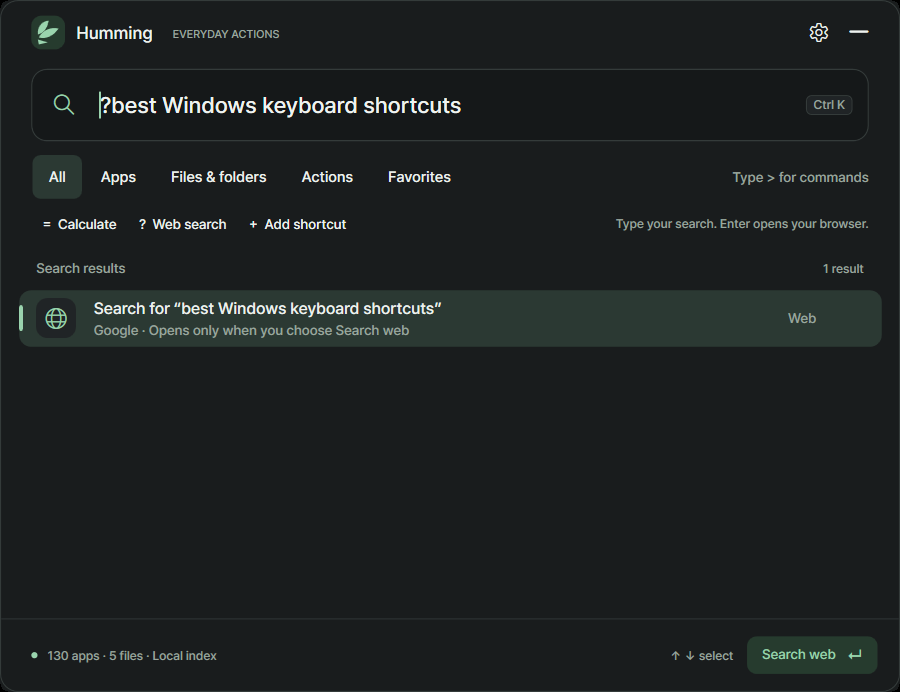
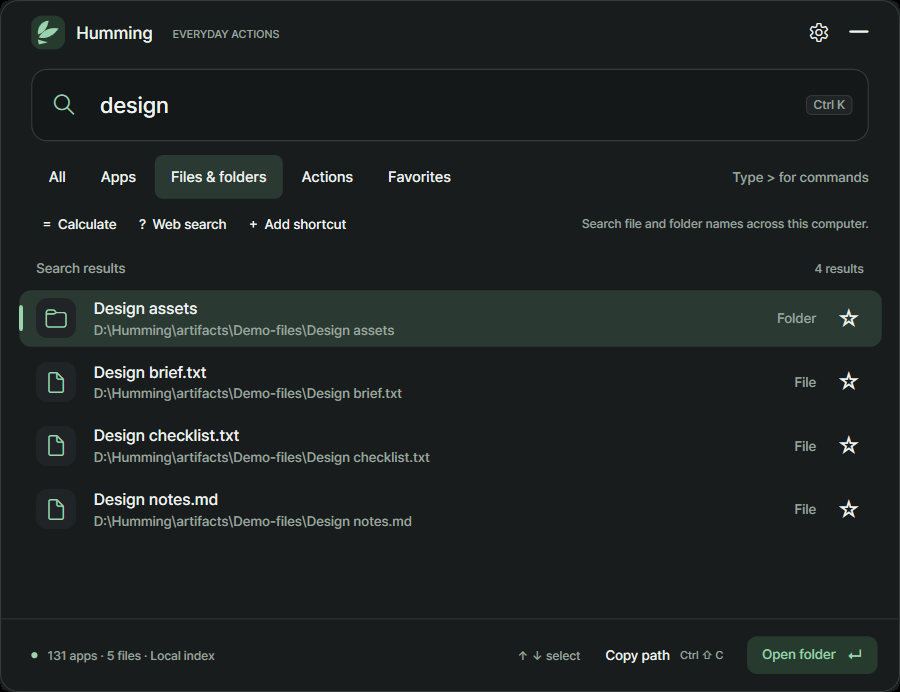

# Humming 0.1.0-beta.3

## A consistent launcher while you change preferences.

This maintenance beta fixes the white background that could appear in the launcher's results area behind Preferences. Your apps, files, calculations and deliberate web searches remain together in one compact Windows launcher.

[**Download Windows Setup**](https://github.com/memeseonew-eng/Humming/releases/download/v0.1.0-beta.3/HummingSetup-0.1.0-beta.3-win-x64.exe) · [**Download portable ZIP**](https://github.com/memeseonew-eng/Humming/releases/download/v0.1.0-beta.3/Humming-0.1.0-beta.3-win-x64.zip) · [SHA-256 checksums](https://github.com/memeseonew-eng/Humming/releases/download/v0.1.0-beta.3/SHA256SUMS.txt)

**Windows 11 x64. Runtime included. App and Setup unsigned.**

## Preferences stays in theme

- **The results background keeps its theme.** Opening Preferences no longer introduces a white block behind the launcher's results.
- **Light and dark previews stay consistent.** The results surface follows the active appearance while the launcher is temporarily disabled behind Preferences.

Preferences still prevents concurrent launcher edits. Close it to return to the launcher and continue searching.

## Web search that starts with your choice

Click **Web search** or type `? windows keyboard shortcuts`, then press **Enter**. Humming opens the Google search in your browser. Preparing a query does not contact Google; activating it does. Ordinary app and filename queries stay on your computer.

## Keep everyday tasks together

- Open installed apps, saved shortcuts, files and folders.
- Search file and folder names across accessible local drives without adding folders first.
- Calculate and copy the answer, or copy a selected file's path.
- Save aliases and favorites; successful-use frequency and recency help order familiar results.
- Choose light or dark appearance, reduced motion and your global shortcut.

## Update to beta.3

Quit Humming before updating. Run the new Setup, or extract the portable ZIP and replace program files while retaining your `data/` folder. Setup retains its separate `%LOCALAPPDATA%\Humming` profile. This appearance fix requires no settings migration.

**Run in the background defaults On. Start with Windows defaults Off.** Both remain independent options in Preferences. Moving a portable copy does not automatically register startup on another machine.

The use/reuse terms, privacy information and release protection introduced in beta.2 continue in beta.3. These measures deter casual copying; they do not make a Windows executable impossible to inspect or copy. Local settings and indexes are not encrypted.

## Privacy, terms and beta limits

The app has no account, telemetry, remote license check or automatic updater. Web and website actions use your browser and the selected provider's policies. Release downloads contain no personal profile or computer index.

Read the included [Humming terms](https://github.com/memeseonew-eng/Humming/blob/v0.1.0-beta.3/LICENSE.txt) and [privacy information](https://github.com/memeseonew-eng/Humming/blob/v0.1.0-beta.3/PRIVACY.md). Bundled third-party components retain their own licenses. These terms reserve only applicable rights; they do not override statutory exceptions or GitHub platform rights.

Initial filename indexing is progressive. Coverage depends on drive access and availability; no file-content search, network-share enumeration or privileged indexing service is included. Separate clean-PC, broader accessibility, mixed-monitor/DPI and slow-device validation remain ongoing. Updates are manual.

[Project and full instructions](https://github.com/memeseonew-eng/Humming) · [Changelog](https://github.com/memeseonew-eng/Humming/blob/v0.1.0-beta.3/CHANGELOG.md) · [Report an issue](https://github.com/memeseonew-eng/Humming/issues)

When reporting a problem, include the app and Windows versions and steps to reproduce. Remove personal filenames, paths, queries and credentials from screenshots or logs.
