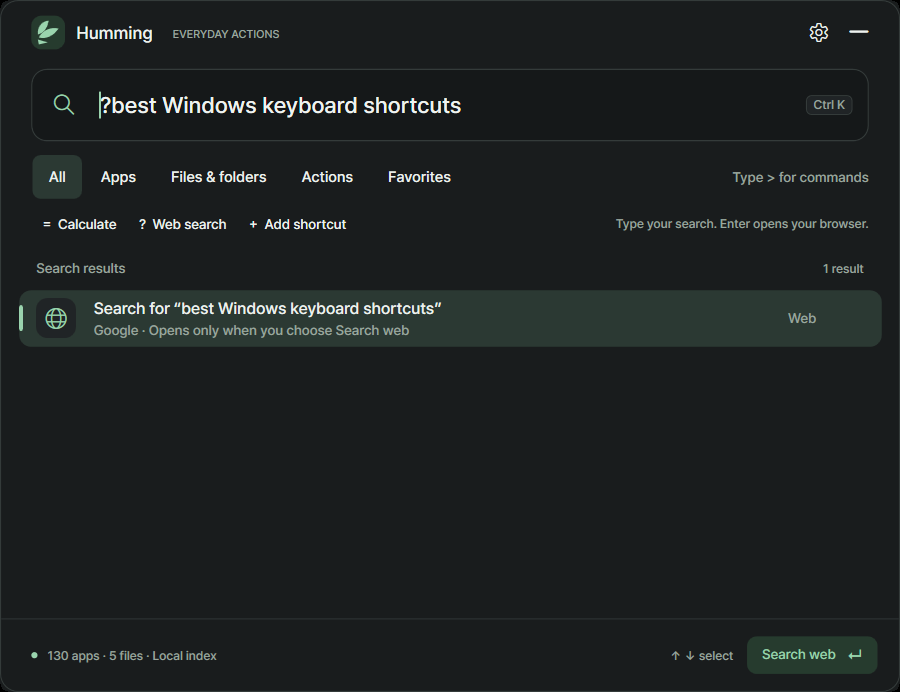
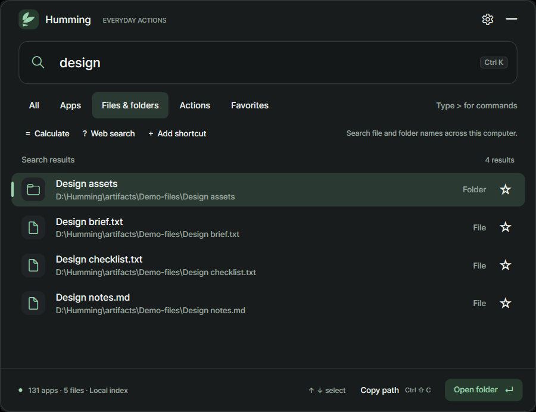

# Humming 0.1.0-beta.4

## Your launcher is now one click away

A small, optional floating button keeps Humming ready when you prefer using a mouse. Click the circular icon to open Humming and focus its search field; drag it to either side of your screen or right-click for quick controls.

[**Windows Setup**](https://github.com/memeseonew-eng/Humming/releases/download/v0.1.0-beta.4/HummingSetup-0.1.0-beta.4-win-x64.exe) · [**Portable ZIP**](https://github.com/memeseonew-eng/Humming/releases/download/v0.1.0-beta.4/Humming-0.1.0-beta.4-win-x64.zip) · [**SHA-256 checksums**](https://github.com/memeseonew-eng/Humming/releases/download/v0.1.0-beta.4/SHA256SUMS.txt)

**Windows 11 x64 · Runtime included · Beta unsigned · Manual updates**

## Small details that stay out of your way

- **Click to search.** The icon opens the familiar compact Humming window, not a new full-screen dashboard.
- **Drag to reposition.** Release it near an edge; it docks left or right and remembers the monitor and height.
- **Disappear when searching.** The floating icon hides while Humming is open and returns after the launcher is dismissed.
- **Right-click actions.** Open Humming, Preferences, Hide floating icon or Quit.
- **Optional.** The setting is in Preferences → Floating launcher. Background execution remains independently optional.
- **Motion and appearance.** Respects light/dark themes and reduced-motion preference.

## Make the icon your own

In Preferences, click **Choose image…** to select a PNG, JPEG, or WebP image supported by Windows. Humming creates a 160-by-160-pixel PNG thumbnail, removes the original metadata, and stores the small image in your private local settings only after Save. **Use Humming icon** resets to the default artwork. No image is uploaded or sent to a server.

## More than just an app launcher

Humming also combines app launching, local filename/folder discovery without manually adding directories, path copying, quick calculations, saved shortcuts, aliases, favorites and deliberate Google search through the visible Web search action.

## Upgrade and privacy

Quit your current Humming process, run Setup or extract the portable ZIP and preserve its data folder. Setup stores preferences separately under the Windows local app-data directory. Existing hotkey and index behavior is unchanged.

**Run in background** defaults On; **Start with Windows** defaults Off. The floating icon is shown only while background mode is enabled and the main launcher is hidden. Custom thumbnails and their source paths are never added to the public packages. A privately selected thumbnail may be included in a private settings backup.

Humming has no account, telemetry, cloud sync, automatic updater or license server. The proprietary release includes modest code obfuscation but is not impossible to inspect. Review [terms](https://github.com/memeseonew-eng/Humming/blob/v0.1.0-beta.4/LICENSE.txt) and [privacy](https://github.com/memeseonew-eng/Humming/blob/v0.1.0-beta.4/PRIVACY.md).

The app and installer are unsigned. Indexing is progressive, limited by filesystem access and not equivalent to Everything's privileged indexing. Separate clean-machine, mixed-monitor/DPI and long-running validation remain open.

[Project page](https://github.com/memeseonew-eng/Humming) · [Changelog](https://github.com/memeseonew-eng/Humming/blob/v0.1.0-beta.4/CHANGELOG.md) · [Report an issue](https://github.com/memeseonew-eng/Humming/issues). Please avoid sharing personal names, paths, thumbnails, or credentials in screenshots or logs.
